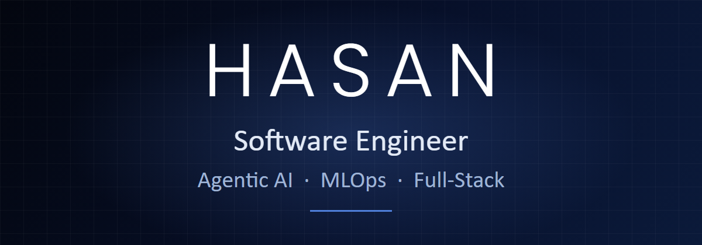
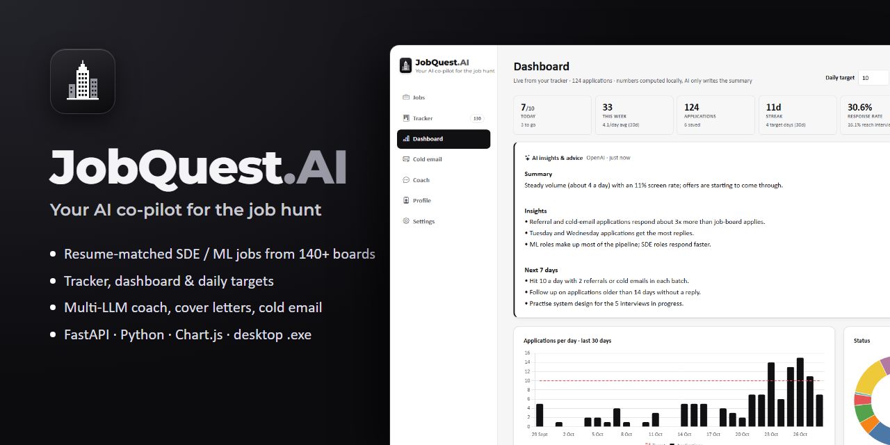

  
  
  
  

Software engineer focused on **agentic AI systems**, **MLOps** and **full-stack development**, based in **Mumbai, India**.
I design LLM agents and the services around them, evaluate and ship ML models, and build the web apps that put them in
front of users. M.S. in Computer Engineering from **The University of Texas at Dallas** (2024 - 2026).

### What I build

| Agentic AI systems | MLOps | Full-stack development |
|---|---|---|
| Multi-agent workflows and ReAct agents in LangGraph, tool calling, RAG pipelines, LLM-as-a-judge evaluation, and multi-provider LLM layers (OpenAI, Gemini, Claude, local models). | Models trained in PyTorch and scikit-learn, served behind FastAPI and Flask, containerised with Docker and deployed on AWS, with automated tests and CI around them. | Python backends (FastAPI, Flask, Django) and React / Express front ends on SQL and MongoDB, through to packaged desktop apps and installers. |

### Experience

| Role | Company | When |
|---|---|---|
| **Machine Learning Engineer**: autonomous LLM QA agent (Playwright, multi-provider LLMs), LLM-as-a-judge evaluation cutting test time 95%, synthetic financial-document generator | Mphasis | Jun 2026 - Aug 2026 |
| **Machine Learning Engineer**: RAG system on ChromaDB + Azure OpenAI (+30% retrieval), FastAPI / LangChain backend optimisation (+20% API performance) | Mphasis | May 2025 - Aug 2025 |
| **Software Engineer**: Python / Flask backend services and internal tools, Docker | Shree Infotech | Apr 2023 - Mar 2024 |
| **Game Developer Intern**: Unity / C# gameplay systems | Dot9 Games, Nilee Games | 2022 - 2024 |

### Tech stack

**Languages** &nbsp;

**AI / ML** &nbsp;

**Backend and data** &nbsp;

**Cloud and DevOps** &nbsp;

**AI dev tools** &nbsp;

### Featured: JobQuest.AI

A desktop AI co-pilot for the job hunt. It ranks entry-level jobs from 140+ company boards against your resume through a
10-provider LLM layer, tracks every application with an analytics dashboard, and drafts cover letters and cold emails. It
also reads recruiter screenshots and syncs with Gmail for you to review. Ships as a Windows installer.
**FastAPI · LLM agents · SQLite · Chart.js · PyInstaller · Inno Setup** &nbsp;·&nbsp; [Repo](https://github.com/striderzz/JobQuest.AI) · [Download](https://github.com/striderzz/JobQuest.AI/releases/latest)

### Personal Projects

| Project | What it does | Built with |
|---|---|---|
| **[NutriCoach](https://github.com/striderzz/langgraph-multiagent-nutrition-coach)** | Multi-agent nutrition coach: ReAct agents with a critic-revise loop, streamed live over Flask SSE | LangGraph, GPT-4o-mini, Flask |
| **[KeepNotes (MERN)](https://github.com/striderzz/MERN-Notes-App)** | Google Keep-style notes app | React, Vite, Express, MongoDB Atlas |
| **[Recipe Manager on AWS](https://github.com/striderzz/recipe-manager-flask-mongodb-aws)** | Full-stack recipe manager, containerised and deployed on AWS | Flask, MongoDB, Docker, AWS |
| **[PyTorch Transfer Learning](https://github.com/striderzz/PyTorch-Transfer-Learning)** | Food image classifier using transfer learning | PyTorch, EfficientNet-B0 |
| **[2D Platformer](https://github.com/striderzz/2D-Platformer-Unity)** | 2D platformer game and starter template | Unity, C# |

More agent work: [ReAct AI Agent](https://github.com/striderzz/AI-Agent-Langraph) · [SQL AI Agent](https://github.com/striderzz/SQL_AI_AGENT) · [Math AI Agent](https://github.com/striderzz/Math-AI-Agent-Langraph)

### Certifications

IBM **Building AI Agents and Agentic Workflows** · Anthropic **Claude Code 101**, **Claude 101**, **Introduction to Claude Cowork** ·
DeepLearning.AI / Stanford **Supervised Machine Learning** · IBM **Machine Learning with Python** · DeepLearning.AI **AI For Everyone** ·
Udemy **Complete SQL Bootcamp**, **Python and Flask Bootcamp** · University of Michigan **Python Data Structures**, **Programming for Everybody**
&nbsp;([verify links](https://striderzz.github.io/portfolio-website/#certifications))

### GitHub

  
  

